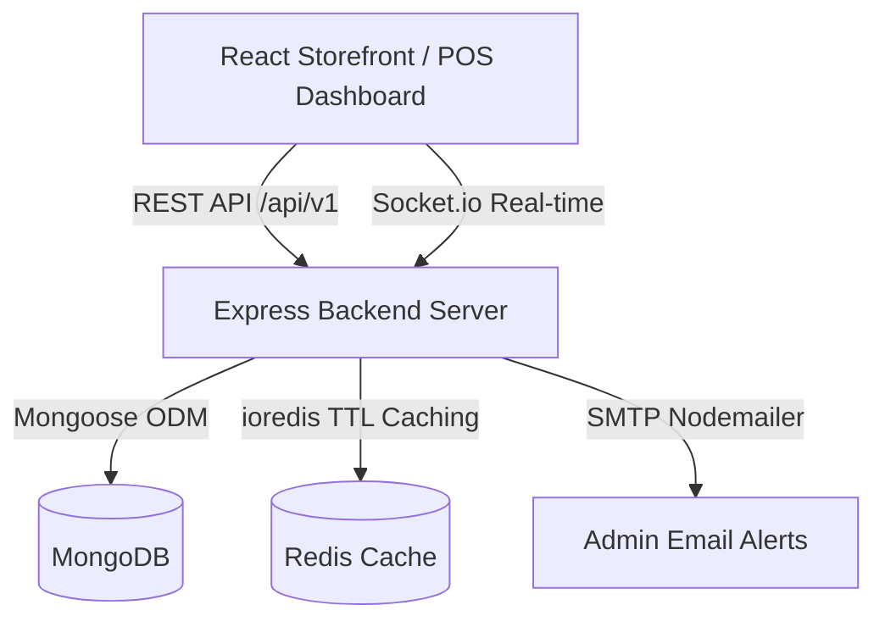

# 🛒 QuickBill — Enterprise POS System

A full-stack **Point of Sale (POS)** application built for retail store management. Designed with a premium dark-themed UI and powered by a robust **MERN stack** (MongoDB, Express, React, Node.js).


[**Live Demo (Coming Soon)**](https://quickbill.example.com) • [**API Documentation**](./API.md)

---

> **Demo Credentials:**
> - **Super Admin:** `username: admin` | `password: quickbill2024`
> - **Cashier:** `username: cashier` | `password: quickbill2024`


## ✨ Features

- **Storefront & POS Terminal** — Modern React-based storefront, product search, categories, cart, and smooth checkout process.
- **Admin Dashboard** — Today's sales, transaction count, recent orders, and graphical sales insights using Chart.js.
- **Inventory Management** — Full CRUD for products, bulk import/export capabilities, and low-stock alerts.
- **Order & Invoice Management** — Complete order history, invoice generation, and status tracking.
- **Customer & Employee Management** — Track customer details, create and manage employee accounts with specific roles.
- **Supplier & Return Management** — Manage supplier contacts and handle customer returns efficiently.
- **Authentication & Security** — Robust JWT-based authentication paired with Firebase Google Sign-in. Built-in security middlewares (Helmet, XSS protection, Rate Limiting).
- **Responsive & Premium UI** — Carefully crafted dark-mode styling with vanilla CSS for optimal performance across all device sizes.
- **Receipt Printing** — Export transactions as PDF receipts (via PDFKit).

## 🛠️ Tech Stack

| Layer | Technology |
|-------|-----------|
| **Frontend** | React 19, Vite, React Router v7, Lucide React (Icons), Vanilla CSS |
| **Backend** | Node.js, Express.js |
| **Database** | MongoDB with Mongoose ODM |
| **Charts** | Chart.js with react-chartjs-2 |
| **Security** | Helmet, express-mongo-sanitize, xss, express-rate-limit |
| **Authentication** | JWT, bcrypt, Firebase Auth, Google Auth Library |

## 🏗️ Architecture Flow



## 🚀 Getting Started

### Prerequisites

- [Node.js](https://nodejs.org/) v18+
- [MongoDB](https://www.mongodb.com/) running locally, or a MongoDB Atlas URI

### Installation

```bash
# Clone the repository
git clone https://github.com/your-username/quickbill-pos.git
cd quickbill-pos

# Install backend dependencies
npm install

# Install frontend dependencies
cd client
npm install
cd ..

# Set up environment variables
# 1. Backend (.env in the root)
cp .env.example .env

# Configure the following inside root .env:
# MONGO_URI=mongodb://127.0.0.1:27017/quickbill
# JWT_SECRET=your_jwt_secret
# GOOGLE_CLIENT_ID=your_google_client_id

# 2. Frontend (.env in the /client directory)
cp client/.env.example client/.env

# Configure the following inside client/.env:
# VITE_FIREBASE_API_KEY=your_firebase_api_key
# VITE_FIREBASE_AUTH_DOMAIN=your_project.firebaseapp.com
# VITE_FIREBASE_PROJECT_ID=your_project_id
# VITE_FIREBASE_APP_ID=your_firebase_app_id
# VITE_FIREBASE_STORAGE_BUCKET=your_project.appspot.com
# VITE_FIREBASE_MESSAGING_SENDER_ID=your_sender_id

### Required Environment Variables

| Variable | Description | Default / Example |
|----------|-------------|-------------------|
| `PORT` | API Server port | `3000` |
| `MONGO_URI` | MongoDB connection string | `mongodb://localhost:27017/quickbill` |
| `REDIS_URL` | Redis connection for cache | `redis://localhost:6379` |
| `JWT_SECRET` | Secret for short-lived access | `super_secret_key` |
| `JWT_REFRESH_SECRET`| Secret for long-lived session | `refresh_super_secret` |
| `SMTP_USER` | Email used for NodeMailer | `admin@quickbill.com` |
| `SMTP_PASS` | SMTP App Password | `1234abcd` |
| `ADMIN_EMAIL` | Destination for stock alerts | `ceo@quickbill.com` |

# Seed the database with sample products and categories
npm run seed

# Start the development servers (runs both backend and frontend concurrently)
npm run dev
```

Open [http://localhost:5173](http://localhost:5173) (or your Vite dev server port) in your browser.

### Docker

The fastest way to spin up the entire cluster (MongoDB, Redis, Node API, Nginx Client):

```bash
docker compose up -d --build
```

## 📁 Project Structure

```text
quickbill-pos/
├── client/                     # React Frontend Setup
│   ├── public/
│   ├── src/
│   │   ├── components/         # Reusable UI components
│   │   ├── config/             # Firebase and other configurations
│   │   ├── context/            # Global React Contexts
│   │   ├── hooks/              # Custom React hooks
│   │   ├── pages/              # Page components (Admin, Storefront, Auth)
│   │   ├── utils/              # Frontend utilities and API handlers
│   │   ├── App.jsx             # Main Application Router
│   │   └── main.jsx            # React Top-Level Entry
│   ├── vite.config.js          
│   └── package.json            
├── server/                     # Node.js Backend Setup
│   ├── config/                 # DB configuration
│   ├── controllers/            # Route business logic handlers
│   ├── middleware/             # Auth wrapper, error handlers
│   ├── models/                 # Mongoose DB schemas
│   ├── routes/                 # Express API routes
│   ├── utils/                  # Backend utilities (e.g. catchAsync, error classes)
│   ├── index.js                # Express App Setup
│   └── seed.js                 # Seeder file for Dummy data
├── package.json                # Root package for backend dependencies & workspace scripts
└── .env                        # Root Environment variables
```

## 📜 Core API Endpoints

| Method | Endpoint | Description |
|--------|----------|-------------|
| `POST` | `/api/auth/register` | Register a new user |
| `POST` | `/api/auth/login` | Email/Password Login |
| `POST` | `/api/auth/google` | Google Firebase Auth verification |
| `GET`  | `/api/products` | Get all products (supports pagination & filtering) |
| `GET`  | `/api/products/:id` | Get product details |
| `POST` | `/api/orders` | Create a new order (Checkout) |
| `GET`  | `/api/invoices/:id` | Get PDF/Document for a specific invoice |

*(Other modules route via `/api/customers`, `/api/employees`, `/api/returns`, `/api/suppliers`, adhering to RESTful standards for full CRUD operations.)*

## 🤝 Contributing

Contributions, issues, and feature requests are welcome! Feel free to open a PR.

## 📄 License

This project is [MIT](LICENSE) licensed.

---

<p align="center">Made with ❤️ by <strong>Anuj Ghodke</strong></p>
