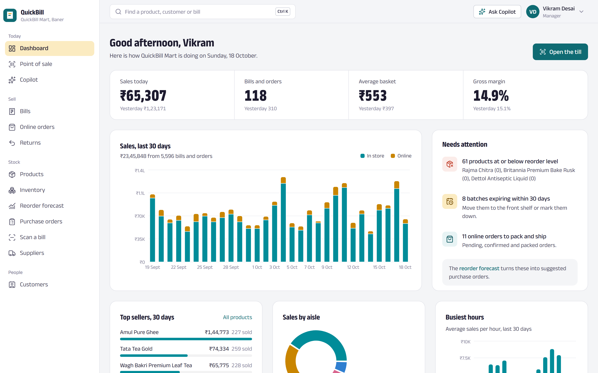
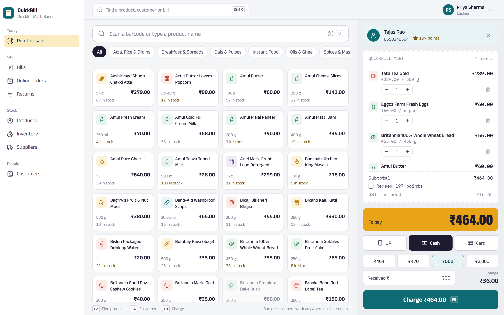
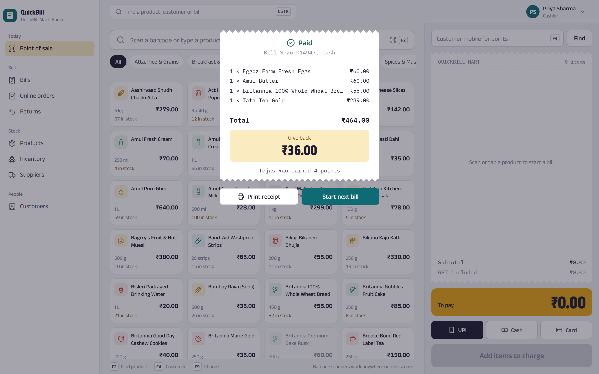
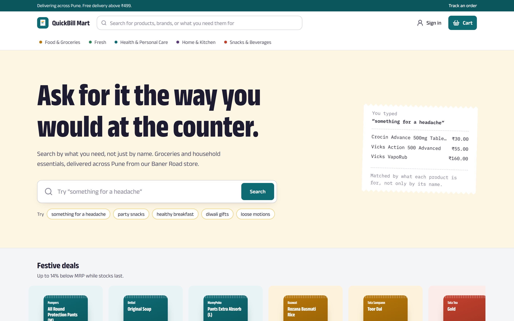
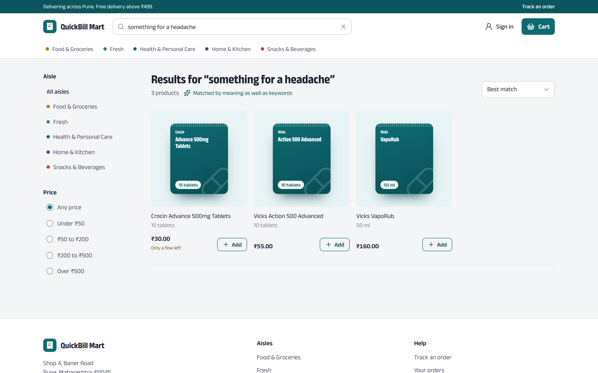
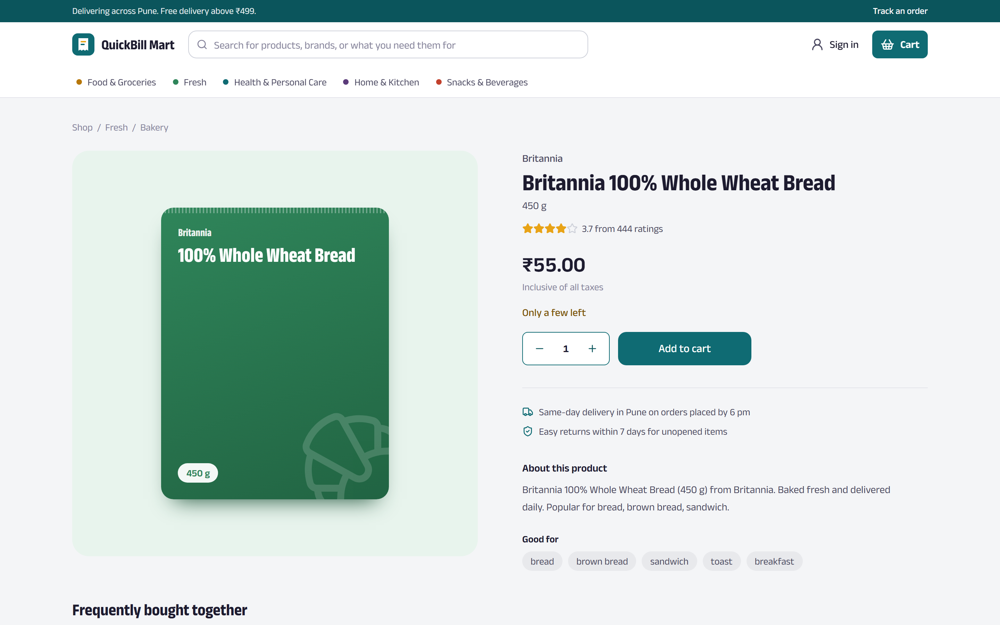
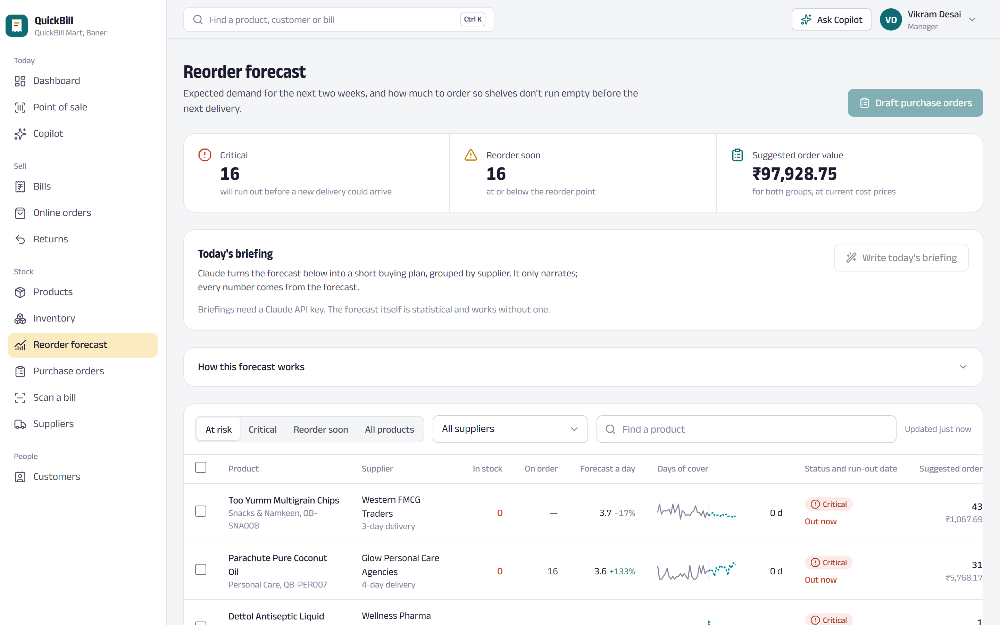
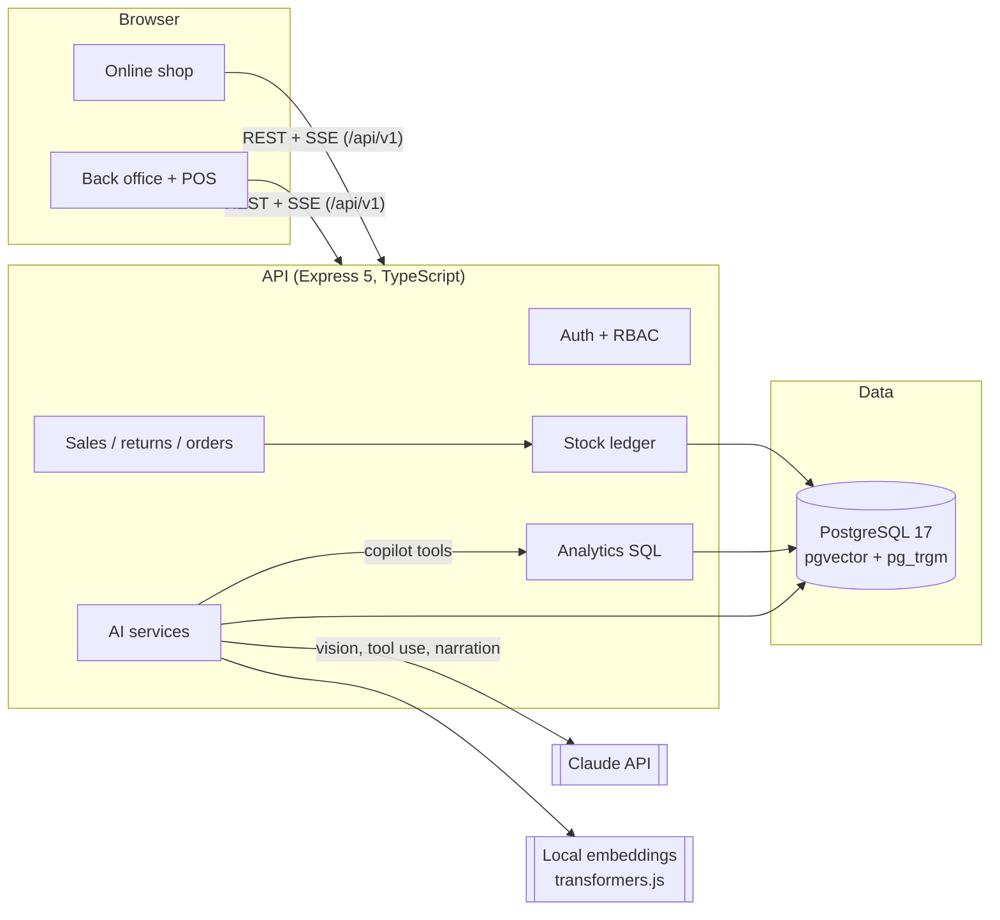

# QuickBill

**The till, the stockroom and the online shop of a neighbourhood grocery store — with AI that reads the numbers for you.**

QuickBill is a full-stack retail platform for an Indian grocery store: a keyboard-first point of sale, a
back office for stock, purchasing and customers, and a customer-facing online shop. On top of the
operational core sit four AI features: an analytics copilot built on Claude tool use, a supplier-bill
scanner using Claude vision, semantic product search, and statistical reorder forecasting.



| Point of sale                                            | Sale complete                                           |
| -------------------------------------------------------- | ------------------------------------------------------- |
|  |  |

| Online shop                                        | Search by intent                                                                   |
| -------------------------------------------------- | ---------------------------------------------------------------------------------- |
|  |  |

| Frequently bought together                                              | Reorder forecast                                   |
| ----------------------------------------------------------------------- | -------------------------------------------------- |
|  |  |

---

## What it does

**Point of sale** — barcode-scanner and keyboard driven (F2 find, F4 customer, F9 charge), GST-inclusive
pricing with the tax breakdown on every bill, UPI / cash / card with change calculation, loyalty points
(earn ₹100 → 1 point, redeem up to half a bill), returns pro-rated for discounts, and a thermal-receipt PDF.

**Back office** — dashboard, bills, online-order fulfilment with an enforced status flow, products and
categories, an append-only stock ledger, purchase orders and goods receiving, suppliers, customers and
staff with role-based access (admin, manager, cashier).

**Online shop** — browse by aisle, search by intent, product pages with recommendations, cart,
guest or signed-in checkout (cash on delivery or a simulated online payment), order tracking, and an
account page. Shoppers who sign up with the phone number they use in store keep their loyalty points.

### AI features

| Feature                   | What the user sees                                                                                                                                         | How it works                                                                                                                                                                                                                                                                                                                                                                                                                                      |
| ------------------------- | ---------------------------------------------------------------------------------------------------------------------------------------------------------- | ------------------------------------------------------------------------------------------------------------------------------------------------------------------------------------------------------------------------------------------------------------------------------------------------------------------------------------------------------------------------------------------------------------------------------------------------- |
| **Analytics copilot**     | Ask "How did this week compare with last week?" and get an answer with charts, streamed live.                                                              | Claude (Opus 5.5) runs a manual tool-use loop over **nine read-only, parameterised analytics tools** (sales summary, top products, customer segments, inventory views, the forecast, …) plus a `show_chart` tool rendered client-side. Streaming over SSE, parallel tool calls, Zod validation of every tool input, conversation history stored append-only so thinking blocks replay correctly. There is deliberately **no free-form SQL tool**. |
| **Supplier bill scanner** | Photograph a supplier invoice; review the extracted lines, matched to your products, then receive the stock in one click.                                  | Claude vision with **structured outputs** (Zod schema) reads the bill. Each line is matched to the catalogue by a blend of trigram similarity and embedding similarity; GSTIN or fuzzy name matching finds the supplier. Confirming creates any new products, a received purchase order and stock movements in one transaction.                                                                                                                   |
| **Search by intent**      | "something for a headache" finds paracetamol; "parle biscuts" still finds Parle-G.                                                                         | **Hybrid retrieval**: Postgres full-text search with stemming, `pg_trgm` for typos, and **pgvector** cosine search over sentence embeddings computed **locally** (all-MiniLM-L6-v2 via transformers.js, no API key). Results are merged with **Reciprocal Rank Fusion**.                                                                                                                                                                          |
| **Recommendations**       | "Frequently bought together" and "You might also like" on product pages; "Picked for you" for signed-in shoppers.                                          | **Market-basket analysis** over POS bills and online orders ranked by **lift** (so milk doesn't top every list); nearest neighbours in embedding space; a shopper's taste centroid for personal picks.                                                                                                                                                                                                                                            |
| **Reorder forecasting**   | A risk-ranked list of what will run out before the next delivery, with suggested quantities, one-click draft purchase orders, and an optional AI briefing. | Weekday seasonality + **Holt's linear exponential smoothing**, safety stock from forecast error at a 95 % service level, lead times per supplier, and **inventory position** (on hand + on order). The maths is deterministic and unit-tested; Claude only narrates it and never does the arithmetic.                                                                                                                                             |

Without an `ANTHROPIC_API_KEY`, everything except the copilot, bill scanner and forecast briefing still
works, and those screens explain how to switch them on.

---

## Architecture



```
apps/
  api/            Express 5 + Prisma 7 · modules: auth, catalog, inventory, sales, returns, orders,
                  purchasing, customers, staff, analytics, storefront, ai (copilot, bill-scan,
                  forecast, search, recommendations)
    prisma/       schema, migrations, deterministic 90-day seed simulation
    test/         integration tests against a real Postgres
  web/            React 19 + Vite · features: shop, admin (POS, dashboard, AI pages, operations), auth
packages/
  shared/         Zod schemas, DTO types, money helpers — shared by API and web
e2e/              Playwright end-to-end tests
```

### Engineering decisions worth knowing

- **Money is integer paise** everywhere (`₹1 = 100`), so totals never drift. Prices are GST-inclusive
  like an Indian MRP; the GST component is derived per line, and bill-level discounts are spread across
  lines so the tax figure stays correct. Slabs follow the 2025 GST 2.0 reform (0 / 5 / 18 / 40 %).
- **Stock can't be oversold.** Every stock change goes through one function that runs a conditional
  `UPDATE … SET stock = stock + Δ WHERE stock + Δ >= 0 RETURNING stock` inside the sale's transaction and
  writes to an append-only ledger. An integration test fires six concurrent checkouts at the last unit
  and asserts exactly one succeeds.
- **Retries are safe.** POS checkouts carry an idempotency key, so a retried request after a network blip
  returns the original sale instead of charging twice.
- **Invoice numbers are gap-free** (`S-26-000124`), allocated from a counter row inside the same
  transaction — GST invoices in India must be sequential.
- **Auth:** Argon2id hashing, constant-time login responses, 15-minute JWT access tokens kept in memory,
  7-day refresh tokens in an `httpOnly` `SameSite=Strict` cookie, stored as HMAC digests, rotated on every
  use, with reuse detection that revokes the whole token family.
- **Public responses are shaped explicitly.** The storefront never sees cost prices, suppliers or exact
  stock; every response goes through a typed mapper rather than returning database rows.
- **Analytics are hand-written, parameterised SQL** over a unified view of in-store bills and online
  orders, bucketed in the store's timezone. The copilot calls the same functions as the dashboard.
- **AI calls are bounded:** per-user rate limits, request aborts when the browser disconnects, server-side
  refusal fallbacks, and a copilot turn is only persisted once it completes cleanly.

### Fixed from the previous version

The revamp replaced a JavaScript/MongoDB app that could not start (three missing dependencies) and had
an unauthenticated endpoint returning any customer's orders by email, regex injection in product search,
non-atomic stock decrements, a token refresh that redirected to a missing route, broken product images
(49 of 66 links returned 404) and no tests. The old code remains in git history.

---

## Tech stack

| Layer    | Choices                                                                                                                                         |
| -------- | ----------------------------------------------------------------------------------------------------------------------------------------------- |
| Frontend | React 19, TypeScript, Vite 8, Tailwind CSS 4, Radix UI, TanStack Query, React Router 7, React Hook Form + Zod, Recharts, cmdk, Zustand          |
| Backend  | Node 24, Express 5, TypeScript, Prisma 7 (driver adapters), Zod 4, Pino, Helmet, express-rate-limit, PDFKit                                     |
| Data     | PostgreSQL 17 with pgvector and pg_trgm                                                                                                         |
| AI       | Claude API (`@anthropic-ai/sdk`: tool use, vision, structured outputs, streaming, Message Batches), transformers.js (local sentence embeddings) |
| Quality  | Vitest + Supertest (unit and integration), Playwright (end-to-end), ESLint, Prettier, GitHub Actions, Docker                                    |

---

## Running it locally

**Prerequisites:** Node 22.12+ (24 recommended) and Docker.

```bash
npm install                                  # installs all workspaces and generates the Prisma client
cp apps/api/.env.example apps/api/.env       # then set the two JWT secrets (command in the file)
npm run db:up                                # Postgres 17 + pgvector in Docker
npm run db:deploy                            # apply migrations
npm run db:seed                              # catalogue + 90 days of simulated trading (~20 s)
npm run dev                                  # API on :4000, web on :5173
```

Open http://localhost:5173 for the shop and http://localhost:5173/admin for the back office.

| Role    | Email                   | Password    |
| ------- | ----------------------- | ----------- |
| Admin   | `admin@quickbill.dev`   | `Demo@1234` |
| Manager | `manager@quickbill.dev` | `Demo@1234` |
| Cashier | `priya@quickbill.dev`   | `Demo@1234` |
| Shopper | `shopper@quickbill.dev` | `Demo@1234` |

The sign-in page also lists these on a receipt — click "use" to fill them in.

**Turn on the Claude features:** add `ANTHROPIC_API_KEY=...` to `apps/api/.env` and restart. The model
defaults to `claude-opus-5-5` and can be changed with `ANTHROPIC_MODEL`. To try the bill scanner, upload
[`docs/sample-bills/western-fmcg-invoice.pdf`](docs/sample-bills/western-fmcg-invoice.pdf)
(regenerate it with `npm run ai:sample-bill -w @quickbill/api`).

Optional AI maintenance scripts (in `apps/api`):

```bash
npm run ai:embed            # embed products missing a vector (--all to rebuild)
npm run ai:enrich           # Claude Message Batches: better search tags + descriptions (--dry-run)
```

### The seed

`npm run db:seed` builds a believable store rather than random rows: 151 products across 19 categories
and 9 suppliers, ~230 customers, and a day-by-day simulation of 90 days of trading — weekday and hourly
patterns, a festive ramp, basket affinities (bread with butter, chips with cola), stock-outs when
deliveries slip, weekly reorder-point tuning, purchase orders arriving after each supplier's lead time,
returns and online orders through their whole lifecycle. It is deterministic, so every run produces the
same data and the stock ledger always reconciles with on-hand stock.

---

## Testing

```bash
npm test             # Vitest: shared helpers, forecasting model, POS maths, cart store,
                     # and API integration tests against a separate quickbill_test database
npm run test:e2e     # Playwright against the production build (run `npm run build` first)
npm run lint && npm run typecheck
```

The API integration suite covers the auth lifecycle (including refresh-token reuse detection), role
checks, checkout pricing, GST and loyalty, the concurrent-checkout race, idempotent retries, returns,
online orders, and that public endpoints never leak cost data. The end-to-end suite rings up a cash sale
at the till, completes a guest checkout, checks role redirects, and searches by intent.

CI (GitHub Actions) runs formatting, lint, type checks, unit and integration tests with a Postgres
service, the production build, the Playwright suite against a freshly seeded database, and a Docker
image build.

---

## Deploying

The Dockerfile builds one image that serves both the API and the web app and applies pending migrations
on start:

```bash
docker compose --profile full up --build     # app on http://localhost:3000 with its own Postgres
```

Any host that runs containers works (Render, Railway, Fly.io) with a managed Postgres that supports
pgvector (Neon, Supabase, RDS). Set `DATABASE_URL`, `JWT_ACCESS_SECRET`, `JWT_REFRESH_SECRET`,
`APP_ORIGIN` and optionally `ANTHROPIC_API_KEY`, then run `npm run db:seed` once for demo data.

---

## Design

The interface is drawn from the store's own world. The palette takes its colours from Indian retail —
ink, peacock blue, turmeric, chilli and leaf — and one typeface, Anek Latin (by Ek Type), is used
across its width axis: condensed and heavy like a shop signboard for headings, normal width for the UI.
The POS bill is printed on till-roll paper, and products without photography get a drawn packshot
coloured by department instead of a broken image. Chart colours are validated for colour-vision
deficiency, chroma and contrast.

---

## Roadmap

- Payment gateway (Razorpay) with webhook-confirmed payments instead of the simulated online payment
- Multiple stores and a central warehouse, with stock transfers
- Offline-first POS (service worker + queued sales) for flaky connections
- Copilot evaluations: a fixed question set with expected figures, run in CI against the seed
- HNSW index on product embeddings once the catalogue grows beyond a few thousand items
